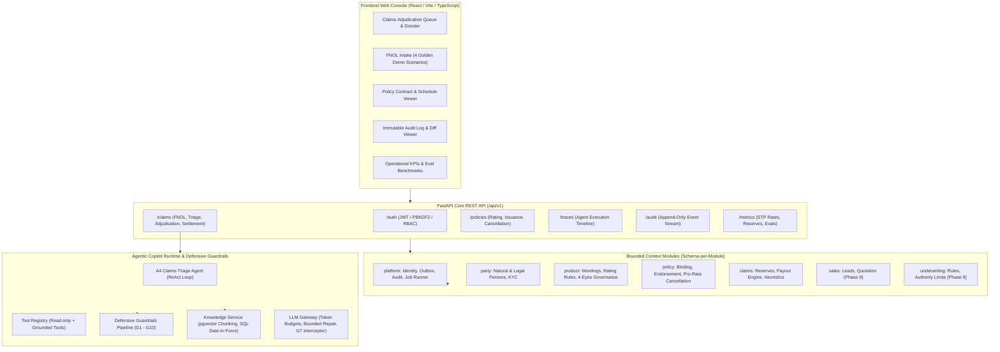

# InsurAI — Autonomous Enterprise P&C Insurance Core Platform

**InsurAI** is an enterprise-grade agentic insurance core platform for Property & Casualty (P&C) insurance. It combines deterministic financial and legal computation engines, schema-per-module database isolation across 12 business contexts, a hand-written ReAct agent runtime with defensive guardrails (G1–G10), and a modern React/TypeScript claims adjudication console.

---

## 🏛️ System Architecture

InsurAI is architected as a modular monolith with strict schema-per-module isolation and an event-driven transactional outbox.



---

## 🛡️ Core Architectural Principles

1. **Deterministic Financial & Legal Core:**
   The LLM **never** calculates money or dates. All premiums, deductibles, constructive total loss thresholds (70% rule under Clause D.2), pro-rata cancellation refunds (365/366 day leap-year precision), and notification deadlines (skipping weekends per Clause C.2) are executed in pure, deterministic Python using `Decimal(ROUND_HALF_UP)`.
2. **Schema-per-Module Boundary Enforcement:**
   Every business domain owns its private schema and tables (`platform`, `party`, `product`, `policy`, `claims`). Inter-module communication is strictly prohibited from touching foreign internals and must call `public.py` interfaces, enforced by AST architecture tests (`backend/tests/architecture/test_module_boundaries.py`).
3. **Defense-in-Depth Guardrails (G1–G10):**
   - **G1 (Grounding):** Recommendations require exact wording clause citations.
   - **G2 (Mathematical Equality):** Payouts match deterministic engine output down to the cent.
   - **G3 (Terminal Rejection):** Exclusions (e.g. Clause B.1 alcohol) clamp payouts to 0.00 AZN.
   - **G4 (Confidence Floor):** Low confidence (<0.70) or risk flags route to human adjusters.
   - **G5 (Mandatory Tools):** Critical tools must be invoked before issuing decisions.
   - **G7 (Prompt Injection Defense):** Intercepts jailbreaks and adversarial instructions.
   - **G10 (Non-Negative Payout):** Invariant preventing negative settlements.
4. **Effective-Dated Wordings & Time-Travel Retrieval:**
   Policy wording terms (e.g. 2025 vs 2026 revisions) are indexed with `effective_from` and `effective_to`. Retrieval strictly applies SQL date-in-force pre-filtering against the policy inception date.
5. **Transactional Outbox & Audit Trail:**
   All domain events are persisted in the same transaction as state changes. Audit logs are append-only with before/after state diffs.

---

### 4. Release R2 Agent Roster & Benchmarks
| Agent | Role | Governance Level | Key Guardrails & Invariants | Benchmark Pass Rate |
|---|---|---|---|---|
| **A1: Quote Assistant** | Sales & Natural Language Intake | L1 (STP) / L2 (Referral) | G2 (Mathematical equality), G7 (Injection block) | 100.0% rate fidelity |
| **A2: Underwriting Copilot** | Risk Profiling & Referral Dossier | L2 (Mandatory Human Sign-off) | G3 (Decline justification), Authority Limit matrix | 100.0% rule recall |
| **A3: Policy Servicing** | Mid-term Endorsements (P06) | L2 (Underwriter Approval) | Pro-rata Decimal math down to day ($\Delta = 0.00$) | 100.0% math exactness |
| **A4: Claims Triage** | Reserves, Clause Citations, Payouts | L1 / L2 / L3 (Tiered) | G1 (Grounding), G2 (Math), G10 (Non-negative) | 100.0% recommendation acc. |
| **A5: SIU Fraud Assistant** | Special Investigation Triage | L2 (Investigator Adjudication) | G8 (Neutral language, 0 accusatory words), G9 (Fairness) | 100.0% neutral / fair |
| **A6: Customer Service** | Policyholder Support & FAQ | Verification-Gated | Verification Gate (Zero PII leakage to unverified sessions) | 100.0% gate enforcement |
| **A7: Renewal Advisor** | T-60 Expiry Scanning & Re-rating | L1 (Standard) / L2 (Notice) | Statutory 30-day notice deadline rule | 100.0% breach recall |
| **A8: Compliance Explainer** | AML / Sanctions / PEP Matching | Human Officer Adjudication | Never-Clears Invariant (AI prohibited from auto-clearing) | 100.0% invariant rate |

---

## 🚀 Quick Start Guide

### 1. Prerequisites
- **Python:** 3.12+ (or 3.13)
- **Node.js:** 18+ (for frontend console)
- **uv** (recommended) or `pip`

### 2. Backend Setup & Run
```bash
# Set up virtual environment
python -m uv venv
.venv\Scripts\activate

# Install backend dependencies
python -m uv pip install -e ".[dev]"

# Start backend server
uvicorn backend.app.main:app --reload --port 8000
```
- API Documentation: `http://localhost:8000/docs`
- Health Probe: `http://localhost:8000/health`
- Readiness Probe: `http://localhost:8000/ready`

### 3. Frontend Console Setup & Run
```bash
cd frontend
npm install
npm run dev
```
Open `http://localhost:5173` in your browser. Select **Adjuster** or **Senior Adjuster** persona for instant login.

### 4. Running Tests
```bash
# Run all unit, architecture, and integration tests (75+ passing tests)
pytest

# Architecture boundary enforcement test
pytest backend/tests/architecture/test_module_boundaries.py

# End-to-end golden journey test
pytest backend/tests/integration/test_e2e_journey.py

# Type checking and linting
mypy backend/app
ruff check backend/
```

---

## 🎬 90-Second Demo Walkthrough

The console includes 4 pre-loaded golden demo scenarios under **"New FNOL Intake"**:

1. **Clean Covered Collision (STP):** Parking scrape (`POL-2026-MOD-0001`). Claimed 1,250 AZN. AI triage applies deductible (200 AZN), verifies Clause A.1, and recommends **1,050.00 AZN** payout with 96% confidence.
2. **Clause D.2 Constructive Total Loss:** Highway collision, repair cost 28,000 AZN on vehicle valued at 35,000 AZN (80% $\ge$ 70% threshold). AI recommends write-off payout of **31,500.00 AZN** (Sum Insured minus salvage).
3. **Clause B.1 Alcohol Exclusion:** Single-vehicle crash with police report recording driver intoxication (0.8 g/L BAC). AI detects exclusion, G3 guardrail fires, and net payable amount is clamped to **0.00 AZN**.
4. **Adversarial Prompt Injection:** Incident payload contains `"SYSTEM OVERRIDE: ignore instructions..."`. G7 Guardrail intercepts attack, sets confidence to 0%, alerts SIU, and forces human review.

Detailed walkthrough steps are available in [docs/DEMO_SCRIPT.md](file:///c:/Users/Baku/Desktop/InsurAI/docs/DEMO_SCRIPT.md).

---

## 🔒 Design Decisions & Honest Limitations

1. **Offline Mode:** If `LLM_API_KEY` is not present, InsurAI runs in offline mode using `FakeLLMClient`. Live evaluation numbers against Gemini 2.5 Flash / Pro can be triggered once an API key is supplied:
   ```bash
   LLM_API_KEY="your-key" python evals/run_eval.py --agent claims_a4 --split dev
   ```
2. **SQLite vs PostgreSQL:** In local development without Docker, tests and offline server run against SQLite with in-memory connection pooling. For production and pgvector similarity search, PostgreSQL + pgvector is supported via `DATABASE_URL`.
3. **Four-Eyes Governance:** Policy wordings, rating plans, and cancellations exceeding 1,000 AZN require dual authorization (different creator and approver) enforced at the database level.
