# InsurAI — Autonomous Enterprise P&C Insurance Core Platform (Release R3)

[](https://github.com/latifovtebriz/InsurAI/actions/workflows/ci.yml)
[](https://opensource.org/licenses/MIT)
[](https://www.python.org/)
[](https://fastapi.tiangolo.com/)
[](https://react.dev/)
[](https://www.typescriptlang.org/)

**InsurAI** is an enterprise-grade autonomous Property & Casualty (P&C) core insurance platform. Built from the ground up to solve the real operational challenges of modern carriers, InsurAI combines:
- **12 Schema-Isolated Domain Modules** with strict AST-enforced architecture boundaries.
- **8 Specialized Autonomous AI Agents (A1–A8)** operating under deterministic guardrails (G1–G10) and tiered autonomy (L1–L3).
- **A Double-Entry General Ledger** enforcing a zero-imbalance mathematical invariant ($\Delta = |Debits - Credits| == 0.00$ AZN) across 13 accounts and quota-share reinsurance treaties.
- **A Full Operational Web Console v2** in React, TypeScript, and Tailwind CSS.
- **Enterprise Observability & Security** with standard Prometheus exposition (`/metrics`), statutory complaint SLA tracking, and an automated zero-leak secret scanner.

---

## 🏛️ System Architecture

```mermaid
graph TD
    subgraph Frontend["Frontend Web Console v2 (React 18 / Vite / TypeScript)"]
        UI_Dash["Executive KPI & Autonomy Matrix Dashboard"]
        UI_Claims["Claims Adjudication Dossier & Override"]
        UI_Quotes["Sales Quotation & Risk Intake"]
        UI_Policies["Policy Administration & Endorsements"]
        UI_Ledger["Double-Entry General Ledger Viewer"]
        UI_Service["Complaints & Statutory SLA Tracking"]
        UI_Traces["Real-Time Agent Execution & Guardrail Traces"]
    end

    subgraph API_GW["FastAPI Core REST API (/api/v1)"]
        AuthRouter["/auth (RBAC Matrix & JWT HS256)"]
        SalesRouter["/sales & /underwriting (Quotes & Risk Binding)"]
        ClaimsRouter["/claims (FNOL, Triage, Payouts)"]
        PolicyRouter["/policies (Issuance, Mid-term Endorsement)"]
        FinanceRouter["/finance (Ledger, Invoices, Disbursements)"]
        FraudRouter["/fraud & /compliance (SIU Cases & Sanctions)"]
        ServiceRouter["/service (Customer Inquiries & Complaints)"]
        MetricsRouter["/metrics & /metrics/executive-kpis (Prometheus & KPIs)"]
    end

    subgraph CoreModules["Bounded Context Modules (Schema-per-Module)"]
        ModPlatform["platform: Identity, Outbox, Audit, Job Runner"]
        ModParty["party: Natural & Legal Persons, Vehicles, Properties"]
        ModProduct["product: Wordings, Rating Rules, Governance"]
        ModPolicy["policy: Binding, Endorsement, Pro-Rata Engine"]
        ModSales["sales: Leads, Quotes, Conversions"]
        ModUW["underwriting: Appetite Rules, Authority Limits"]
        ModClaims["claims: Reserves, Payout Engine, Settlement"]
        ModFinance["finance: Double-Entry Ledger, Invoicing, Banking"]
        ModFraud["fraud: Signal Scoring, SIU Investigation"]
        ModCompliance["compliance: Watchlists, Sanctions, KYC"]
        ModService["service: Endorsement Drafts, Statutory Complaints"]
        ModReinsurance["reinsurance: Quota-Share Treaties & Recoveries"]
    end

    subgraph AgentRuntime["Agentic Copilot Runtime & Defensive Guardrails"]
        A_Agents["Agents A1 to A8 (ReAct Loop)"]
        ToolRegistry["Tool Registry (Strict Pydantic Validation)"]
        Guardrails["Defensive Guardrail Pipeline (G1 - G10)"]
        KnowledgeSvc["Knowledge Service (pgvector Chunking, Date-in-Force)"]
        LLMGateway["LLM Gateway (Token Budgets, Fail-Safe Fallbacks)"]
    end

    Frontend --> API_GW
    API_GW --> CoreModules
    SalesRouter --> AgentRuntime
    ClaimsRouter --> AgentRuntime
    FraudRouter --> AgentRuntime
    ServiceRouter --> AgentRuntime
    AgentRuntime --> KnowledgeSvc
    AgentRuntime --> Guardrails
    CoreModules --> ModPlatform
```



---

## 🤖 Specialized AI Agent Roster (A1 – A8)

| Agent | Operational Domain | Autonomy Level | Guardrails & Invariants | Automated Capability |
|---|---|---|---|---|
| **A1: Quote Assistant** | Sales & Natural Language Intake | Level 1 (STP) / Level 2 (Referral) | G2 (Math Invariant), G7 (Prompt Injection) | Generates actuarial quotes from customer conversations |
| **A2: Underwriting Copilot** | Commercial & Complex Risk Profiling | Level 2 (Human Underwriter Sign-off) | G3 (Decline Justification), Authority Matrix | Evaluates risk attributes against underwriting appetite |
| **A3: Policy Servicing** | Mid-term Endorsements & Complaints | Level 2 (Adjuster Approval) | Pro-rata Decimal arithmetic down to the day | Drafts prorated endorsements and statutory complaint letters |
| **A4: Claims Triage** | Motor OD & Property Loss Adjudication | Level 1 ($\le 2,500$ AZN) / Level 2 ($> 2,500$ AZN) | G1 (Citations), G2 (Math), G10 (Non-negative) | Retrieves effective clauses, calculates payable settlements |
| **A5: SIU Fraud Assistant** | Anomaly Detection & Special Investigation | Level 2 (SIU Investigator Adjudication) | G8 (Neutral Language), G9 (Fairness Blindness) | Detects anomaly clusters without defamatory language |
| **A6: Customer Support** | Policyholder FAQ & Coverage Inquiries | Verification-Gated | Verification Gate (Zero PII to unauthenticated callers) | Answers policy wording questions grounded in contracts |
| **A7: Renewal Advisor** | Expiry Scanning & Re-rating | Level 1 (Standard) / Level 2 (High Risk) | Statutory 30-day notice deadline rules | Scans policies at T-60 days; prepares renewal terms |
| **A8: Compliance Explainer** | AML, PEP & Sanctions Screening | Level 3 (Compliance Officer Sign-off) | **Never-Clears Invariant** (AI cannot auto-clear) | Explains secondary watchlist matches to officers |

---

## ⚡ Quick Start: Turnkey Local Setup (30 Seconds)

### 1. Prerequisites
- **Python**: 3.12+ (or 3.13)
- **Node.js**: 20+ (for frontend console)
- **uv** (recommended) or `pip`

### 2. Single-Command Demo Seeding
InsurAI includes a zero-dependency turnkey seeder that automatically tests database connectivity and provisions all 12 modules:
```bash
# Set up virtual environment and install dependencies
uv venv
source .venv/bin/activate  # On Windows: .venv\Scripts\activate
uv pip install -e ".[dev]"

# Provision seed demo environment (100% offline fallback to SQLite if Postgres is offline)
python scripts/seed_demo_data.py
```
*Output*: Provisions 13 chart-of-accounts, 2 reinsurance treaties, 10 parties, 8 vehicles, 6 properties, 8 active policies, 8 claims across all statuses, 3 complaints, and posts balanced journal transactions with **$\Delta = 0.00$ AZN**.

### 3. Start Backend & Frontend
```bash
# Terminal 1: Backend API
uvicorn app.main:app --port 8000 --reload

# Terminal 2: Frontend Console
cd frontend
npm install
npm run dev
```
- **Web Console**: `http://localhost:5173`
- **Swagger Documentation**: `http://localhost:8000/docs`
- **Prometheus Metrics**: `http://localhost:8000/metrics`
- **Executive KPIs**: `http://localhost:8000/api/v1/metrics/executive-kpis`

---

## 🧪 Comprehensive Verification Suite

InsurAI enforces 100% green builds across every commit and phase:

```bash
# 1. Run all unit, architecture, robustness, and golden journey tests (129+ tests)
pytest

# 2. Strict architecture boundary verification (AST imports)
pytest backend/tests/architecture/test_module_boundaries.py

# 3. 12-Step Full Lifecycle Golden Journey integration test
pytest backend/tests/integration/test_full_lifecycle_golden_journey.py

# 4. Chaos, robustness, and security mitigation tests
pytest backend/tests/unit/test_chaos_and_robustness.py backend/tests/unit/test_security_mitigations.py

# 5. Type safety analysis (0 errors across 140+ files)
mypy backend/app

# 6. Linter and code formatting
ruff check .
ruff format --check .

# 7. Frontend typecheck and production build
cd frontend && npm run build

# 8. Pre-push security and hygiene scanner
python scripts/secret_scanner.py
```

---

## 📊 Observability & Telemetry

InsurAI exposes production-grade observability endpoints per **Architecture 3.13**:
- `GET /health`: Instant liveness probe.
- `GET /ready`: Readiness probe validating database pool connection and outbox backlog queue depth.
- `GET /metrics`: Standard Prometheus exposition format (`http_requests_total`, `agent_run_duration_seconds`, `llm_token_usage_total`, `guardrail_downgrade_total`, `claims_triage_decision_total`, `general_ledger_balance_difference`, `insurai_active_policies_total`, `insurai_total_reserves_azn`).
- `GET /api/v1/metrics/executive-kpis`: Real-time operational JSON telemetry for leadership dashboards.

For alert rules, SLOs, and incident SOPs, see [docs/observability.md](file:///c:/Users/Baku/Desktop/InsurAI/docs/observability.md).

---

## 🔒 Security & AI Governance

- **Threat Model**: Complete STRIDE analysis and OWASP Top 10 for LLMs defense-in-depth detailed in [docs/security.md](file:///c:/Users/Baku/Desktop/InsurAI/docs/security.md).
- **AI Governance**: Detailed autonomy matrix, statutory CBA alignment, human oversight points, and algorithmic fairness guarantees detailed in [docs/ai-governance.md](file:///c:/Users/Baku/Desktop/InsurAI/docs/ai-governance.md).
- **Interview & Architectural Deep-Dive**: 10 tough interview questions, 5 hardest problems solved, and real telemetry metrics in [INTERVIEW_NOTES.md](file:///c:/Users/Baku/Desktop/InsurAI/INTERVIEW_NOTES.md).
- **Live 5-Minute Demo Walkthrough**: 4 golden demo scenarios detailed in [DEMO_SCRIPT.md](file:///c:/Users/Baku/Desktop/InsurAI/DEMO_SCRIPT.md).

---

## 📄 License

This project is licensed under the MIT License - see the [LICENSE](file:///c:/Users/Baku/Desktop/InsurAI/LICENSE) file for details.
